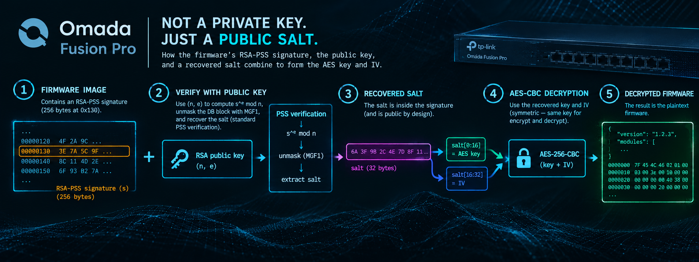

## Introduction

I've been messing around with TP-Link firmware images for a while now and I figured why not write a blog about decrypting the latest firmware image (4.0.0 Build 20260914) for their Omada Fusion Pro 2.5G and shed the light on firmware "encryption" wekanesses that are very common.

## A first look

The image is a 1.27 GB `.bin` bundled with a GPL licence PDF. Throwing the `.bin` at `file` we get: `data`, and binwalk finds nothing at all:

*binwalk 3.1.0 — 85 signatures, 187 magic patterns*

```
Analyzed 1 file for 85 file signatures (187 magic patterns) in 1.4 seconds
(no results)
```

This is already a very strong sign that the image is encrypted.

Before reaching for tools, let's measure some things. A full pass over the payload gives a byte histogram and a 16-byte block census:

*Entropy and ECB census over 0x1000 → EOF*

```
16B blocks: 79588120   duplicates: 0   ratio 0.000000
byte entropy: 8.000000 bits/byte over 1273409920 bytes
distinct bytes: 256
byte freq min/max: 4967912 / 4980589 (expected 4974257.5)
```

Perfect entropy, and **zero** duplicate blocks in 79.6 million. A 1.27 GB root filesystem image is full of zero runs, so under ECB those would collide constantly. Zero collisions means a chaining or counter mode: CBC or CTR perhaps. So that rules out a weak mode like ECB and means we need to start looking for the key.

## The header is cleartext, so let's read it

The first 0xC00 (3 KB) is not encrypted — that is where the encrypted region begins. It has a structure:

*Offset 0x00*

```
00000000: 0000 0001 aa55 d98f 0000 1000 4be6 c180  .....U......K...
00000010: 4588 7958 781b 99f5 5f04 f1f8 4d16 9a83  E.yXx..._...M...
00000020: 0000 0000 0000 0000 0000 0000 0000 0000  ................
          … zeros to 0x12f …
00000130: 553a 3bed 4212 686f 1d62 1cf8 2788 bb2c  U:;.B.ho.b..'..,
          … 256 bytes, entropy 7.14 …
00000230: 0000 0000 0000 0000 0000 0000 0000 0000  ................
          … zeros to 0xbff …
00000c00: 3c0b fb16 a26b dddb ca4f 96b8 8e13 83a2  <....k...O......
          … high entropy, continuous to EOF …
```

Mapping non-zero runs over the first 4 KB gives us three main islands: 16 bytes at `0x10`, 256 bytes at `0x130`, and then unbroken high-entropy data from `0xc00` onward. The word at `0x0c` is `0x4BE6C180` = **1,273,414,016**, which is the exact file size. That one equality confirms the header is a real plaintext structure rather than just noise.

## TP-Link ships the spec

The firmware image belongs to TP-Link **Omada Fusion Pro 2.5G**, which is a gateway, Omada controller and video management system in one box, that explains the 1.27 GB image.
So I started looking for sibiling firmware images that might provide me with more information about the current firmware image that I'm trying to decrypt, and that's exactly what I found!

TP-Link publishes GPL source for the non-Pro sibling, and that archive is all we need. It is 409 MiB and contains an OpenWrt-based SDK named `omada_gateway`.

Inside it, `tplink/configs/fusion_2.5g_un_v1/makeflash.py` builds the upgrade file and simply declares the format:

*omada_gateway/tplink/configs/fusion_2.5g_un_v1/makeflash.py*

```python
header_magic = 0xAA55D98F

def generate_up_file(output_dir, filename, config_json):
    up_file_header_size = 4096
    up_file_header = {                  # total header size is 4K
        "version":0x1,                  # 4 bytes
        "magic":header_magic,           # 4 bytes
        "header_len":4096,              # 4 bytes
        "total_len":0x00,               # 4 bytes
        "md5":"",                       # 4x4=16 bytes
        "aio_version":"",               # 16 bytes
        "reserved1":"",                 # 256 bytes
        "rsa":"",                       # 256 bytes, start addr is 0x130=304
        "reserved2":""                  # 3536 bytes
    }
```

There it is in a comment: a 256-byte RSA field at `0x130`. Every field matches the the structure in our `.bin` byte for byte. The same script shows the entry table that follows at `0x1000`: 64-byte big-endian records of `name[32]`, `base`, `size`, `offset`, `length`, `type`.

*Header layout of our target `.bin`*

| Offset | Size | Field | Value in target |
|---:|---:|---|---|
| 0x000 | 4 | version | 1 |
| 0x004 | 4 | magic | 0xAA55D98F |
| 0x008 | 4 | header_len | 4096 |
| 0x00C | 4 | total_len | 1273414016 = file size |
| 0x010 | 16 | md5 | 45887958…4d169a83 |
| 0x020 | 16 | aio_version | zeros |
| 0x030 | 256 | reserved1 | zeros |
| 0x130 | 256 | rsa | signature (byte-reversed) |
| 0x230 | 3536 | reserved2 | zeros to 0xbff, then payload |
| 0x1000 | 4096 | entry table | encrypted |
| 0x2000 | — | payloads | encrypted |

## The design flaw, in TP-Link's own words

The cipher is clearly documented in TP-Link Tapo C310 v2 GPL's `libsecurity`, published with their camera source. The function `rsa2_pss_sha256_verifysig()` verifies an EMSA-PSS/SHA-256 signature, recovers the salt, and then does this:

*rsaVerify.c - rsa2_pss_sha256_verifysig()*

```c
printf("key/iv:\nKEY=");
for(i = 0; i <16; i++)  printf("%02x",salt[i]);
printf("\nIV=");
for(i = 16; i <32; i++) printf("%02x",salt[i]);

if (memcmp(hash, hash2, hashLen)) {
    printf("RSA PSS Verify Error 3!\n");
    ret = 0;
} else {
    /* Decryption */
    if (!bCheckOnly && slen > 32 && memcmp(data + 0x240, magic, 20)) {
        struct AES_key aes;
        AES_set_decrypt_key(salt, 128, &aes);
        AES_cbc_encrypt(data + data_dec_offset, data + data_dec_offset,
                        (datalen - data_dec_offset) & ~0xF, &aes, salt + 16, 0);
        result = 1;
    }
}
```

The AES-128 key is `salt[0:16]` and the CBC IV is `salt + 16`. The vendor's own debug `printf` even labels them `KEY=` and `IV=`.

> **Why this is fatal**
>
> In RSA-PSS the salt is NOT a secret. Verification *recovers* it: you compute `s^e mod n` with the **public** exponent, unmask the DB block with MGF1, and the salt falls out. That is how PSS verification works by construction.
>
> So deriving the AES key from the salt means every party who can verify the firmware can also decrypt it, and the public key (which is used for verification) ships inside the product. There is no secret anywhere in the chain.

Going back to the non-Pro Fusion GPL dump, I was able to disassemble/decompile `rsaVerify(.c)` (under `package/utils/uboot-envtools/src/`) is a few hundred lines of PKCS#1 v1.5 only with no PSS, no AES. The PSS-plus-AES path exists in the Fusion family as **compiled code**.

*Disassembly of rsa2_pss_sha256_verifysig @0x1b427, dkmgt_firmware_make*

```nasm
0001b616  call  0x15966   ; RSA_SHA256_MGF1
0001b7e0  call  0x158da   ; RSA_SHA256_Simple
0001b80b  call  0x158da   ; RSA_SHA256_Simple
0001b84c  cmp   dword ptr [rbp - 0x37c], 0x20   ; require salt len > 32
0001b855  lea   rdx, [rbp - 0x350]              ; &aes
0001b85c  mov   rax, qword ptr [rbp - 0x370]    ; rax = salt
0001b863  mov   esi, 0x80                       ; 128 bits
0001b868  mov   rdi, rax                        ; key = salt
0001b86b  call  0x5ef8    ; AES_set_decrypt_key
0001b877  lea   rcx, [rax + 0x10]               ; iv = salt + 16  <-- the bug
0001b881  and   eax, 0xfffffff0                 ; len &= ~0xF
0001b89b  mov   r9d, 0                          ; forward = 0 (decrypt)
0001b8ac  call  0x7784    ; AES_cbc_encrypt
```

WE see a 128-bit key taken from the salt pointer, IV at `salt+0x10`, length truncated to a block multiple, direction flag 0.

## Finding the public key

The key is a Microsoft `PUBLICKEYBLOB` stored as base64. My first sweep of all 45,532 files inside the sibling GPL image found nothing, because I searched for the prefix `BgIAAAwk` that previously published TP-Link keys start with. This key begins `BgIAAACk` — the difference is `aiKeyAlg`, `0x0000a400` (`CALG_RSA_KEYX`) rather than `0x0000240c`. Widening the search to `BgIAAA` found exactly one distinct key across the whole archive.

It appears both in readable source and compiled into binaries:

- `package/utils/uboot-envtools/src/fw_rsa_verify.c` — as `teRsaPubKey`, split across C string literals
- `staging_dir/host/bin/dkmgt_firmware_make` — as the symbol `rsaPubKey`
- `usr/sbin/dkmgt`, `usr/sbin/cli_server`, `usr/sbin/rsa_sign_verify`, and both `fip.bin` bootloader images

Because `dkmgt_firmware_make` is not stripped, the symbol can be read out and checked exactly:

*readelf + decode of the rsaPubKey symbol*

```
203: 0000000000247240   369 OBJECT  LOCAL  DEFAULT   23 rsaPubKey

file offset       : 0x47240
len incl NUL      : 369        NUL-terminated : True
b64 string length : 368
blob len / bType / bVersion / aiKeyAlg : 276 / 0x06 / 0x02 / 0x0000a400
magic b'RSA1'  bitlen 2048  pubexp 65537
```

The same RSA-2048 key is used for two things: firmware verification, and the factory debug-CLI challenge which banner reads `Sign Platform: TP-LINK_SMB_GATEWAY_RSA2048_PSS`.

*The public key (as published in their GPL release)*

```
BgIAAACkAABSU0ExAAgAAAEAAQDNiuMM+XiH3Vd9HNY2dGW8GFAvI6pQ6CaABZZ2
MB5tcItRRqlo0MnUJN6eRdAM9F66QhoVDJFytzcbj4n5QPFkygFcQ0jrRRI0NUoP
ZIwzk7y5ayJmjPie9dBXDcHkaQVnnjL1c7YxAVW2EACRj14Kv7PbMbv3o5x/U43F
seU0srFuED2uAZ4UWgKMNTnAoz0W1xqr5OXBbzuU4KNFXy4ySK/oAQIPw14tiUq2
8k+srUchUgPfvY33XD+sdVO43GFKxkKmH9IFwlBTMzMEab0IXZfbj33SQ5dsAQpP
qktZIp8fkVkX+cYKCoBQK4aQsNoeJIc/wpYpnyVg1q/dPPKx
```

Note the blob stores its modulus **little-endian**. TP-Link's parser reverses it byte by byte into a scratch buffer before handing it to a big-endian bignum constructor, so `n = int.from_bytes(modulus_bytes, "little")`.

## Asking the packaging tool where to look

Now that I had the key, I needed to locate the signature and where the encrypted data sit in my target `.bin`, I read the vendor's own verifier. `dkmgt_firmware_make` is an unstripped x86-64 ELF.

`dkmgt_check_rsa` copies 256 bytes from `buf + 0x130` onto the stack, then calls the verifier:

*dkmgt_check_rsa @0x227f2 — the call setup*

```nasm
00022867  add   rax, 0x130                  ; sig source
          … 256 bytes copied to [rbp-0x120] …
000229ed  lea   r12, [rax + 0xc00]           ; pInData   = buf + 0xC00
000229de  sub   eax, 0xc00                     ; inDataLen = len - 0xC00
000229f4  lea   rdi, [rip + 0x224845]          ; -> 0x247240 rsaPubKey
00022a0a  mov   r9d, 0x100                     ; inSignatureLen = 256
00022a20  call  0x1bbc3  ; rsaVerifyPSSSignByBase64EncodePublicKeyBlob
```

Two facts were immediately clear: the signature really is the 256 bytes at `0x130`, and the signed and encrypted region starts at **`0xC00`**.

## The signature is stored backwards

So now the key and offsets were known, one question remained: byte order. TP-Link's bignum layer reverses buffers in several places, so I brute-forced every offset in the header at single-byte granularity, trying the signature both as-is and reversed (because it was just so easy to do):

*Offset × endianness sweep, both images*

```
Fusion_2.5Gv1_un_1.0.30 …
  0x0018 fwd: 0xbc trailer -> bad PS byte 0x0e at 0
  0x0130 rev: 0xbc trailer -> PSS VALID
     KEY=b1145466ca135fb597a81c0fc7674b09 IV=2ca0e734a7e401263542062de2c6bebc slen=222
  0x0b9c fwd: 0xbc trailer -> bad PS byte 0x3c at 0
  valid PSS blocks found: 1

Fusion_Pro_common_4.0.0 …
  0x011f fwd: 0xbc trailer -> bad PS byte 0x22 at 0
  0x0130 rev: 0xbc trailer -> PSS VALID
     KEY=ff539b0fc4ca8ec53fbeef2e0ec5ab51 IV=a0e333a6040fe9a3d97ecfad43ffdbb9 slen=222
  valid PSS blocks found: 1
```

One valid block per image, at the documented offset, with the signature read little-endian. The other `0xbc` hits are the expected chance collisions and of course all fail the padding check immediately.

I was able to confirm the order later via `libsecurity` which does the same: it reverses the signature before verifying it. `rsaVerifySign()` in `rsaVerify.c` copies it into `signBuf` back to front.

Note `slen=222`. The separator sits at `DB[0]`, so the padding string is **empty** and TP-Link uses a maximal 222-byte salt of which only the first 32 bytes are ever used:

```
EM = s^e mod n  (256 bytes, big-endian)
+--------------------------------------+----------------+----+
|            maskedDB · 223            |     H · 32     | bc |
+--------------------------------------+----------------+----+
                                               |
                 MGF1-SHA256(H) XOR maskedDB   |
                   +---------------------------+
                   v
DB (223 bytes)
+----+-------------------------------------------------------+
| 01 |                      salt · 222                       |
+----+-------------------------------------------------------+
  |   PS is empty — separator sits at DB[0]
  v
salt
+--------------+--------------+------------------------------+
| AES KEY · 16 |   IV · 16    |         unused · 190         |
+--------------+--------------+------------------------------+
```

## Now we decrypt and verify it actually works

Header taken as is up to `0xC00`, then AES-128-CBC with no padding:

*Decrypt*

```bash
K=ff539b0fc4ca8ec53fbeef2e0ec5ab51
IV=a0e333a6040fe9a3d97ecfad43ffdbb9

head -c 3072 "$FW" > out.bin
tail -c +3073 "$FW" | openssl enc -d -aes-128-cbc -nopad -K $K -iv $IV >> out.bin
```

And the immediate successful decryption proof is the entry table at `0x1000`, which was high-entropy noise and is now plainly readable: partition names in ASCII, with the 64-byte stride `makeflash.py` described:

*Decrypted entry table at 0x1000*

```
00000400: 6d62 7200 0000 0000 0000 0000 0000 0000  mbr.............
00000420: 0000 0000 0000 0000 0000 0000 0001 0000  ................
00000430: 0000 2000 0000 4400 0000 0001 0000 0000  .. ...D.........
00000440: 7061 7274 6974 696f 6e00 0000 0000 0000  partition.......
00000480: 7375 7070 6f72 742d 6c69 7374 0000 0000  support-list....
000004c0: 736f 6674 7761 7265 2d69 6e66 6f00 0000  software-info...
```

Also now readable, the JSON metadata which confirms the image identity:

*software-info*

```
"firmware-info": { "firmware-version": "4.0.0 Build 20260914 Rel.73217" }
"Network-info":  { "firmware-version": "6.3.20.1 Build 20260914 Rel.73217" }
"Guard-info":    { "firmware-version": "2.3.0 Build 20260914 Rel.73217" }
"support-list":  [ "Fusion Pro 2.5G" 1.0, "Fusion Pro 2.5G PoE" 1.0 ]
```

*Ten partitions, 1,273,405,810 bytes total*

| Partition | Offset | Length | Type |
|---|---:|---:|---|
| mbr | 0x2000 | 17,408 | DOS/MBR + GPT |
| partition | 0x6400 | 9,405 | JSON |
| support-list | 0x88c0 | 268 | JSON |
| software-info | 0x89e0 | 1,085 | JSON |
| kernel-dtb | 0x8e30 | 14,864,204 | Device Tree Blob v17 |
| rootfs | 0xe35d80 | 274,333,696 | SquashFS 4.0 / xz · 11,155 inodes |
| EAPController-package | 0x113d5d80 | 463,633,408 | ext4 |
| Central-package | 0x2cdfd980 | 246,336,512 | ext4 |
| NVR-package | 0x3b8ea580 | 23,293,952 | ext4 |
| VMS-package | 0x3cf21580 | 250,915,840 | ext4 |

Unpacking the file system of the firmware image (`rootfs.bin`) gives 810 MB across 22,811 files: OpenWrt Barrier Breaker 14.07 on `mediatek/generic`, ARM64, with nginx running as root, a Lua captive portal, a Java Omada controller and the VMS stack.

| Field | Value |
|---|---|
| **Image** | Fusion Pro 2.5G 4.0.0 Build 20260914 |
| **AES-128-CBC key** | `ff539b0fc4ca8ec53fbeef2e0ec5ab51` |
| **IV** | `a0e333a6040fe9a3d97ecfad43ffdbb9` |
| **Region** | 0xC00 → EOF |
| **Salt length** | 222 bytes (PS empty) |

Keys are per-image, derived from each file's own signature. The sibling Fusion 2.5G 1.0.30 image yields `b1145466ca135fb597a81c0fc7674b09` / `2ca0e734a7e401263542062de2c6bebc` by the identical process.

## 09. The tool

Here's a small script that decrypts and unpacks our target firmware image.

*tplink_decrypt.py — info \| decrypt \| unpack*

```python
#!/usr/bin/env python3
"""Decrypt + unpack TP-Link Omada firmware images (magic 0xAA55D98F)."""
import hashlib, os, struct, sys, base64

MAGIC      = 0xAA55D98F
HEADER_LEN = 0x1000
SIG_OFF    = 0x130
SIG_LEN    = 0x100
DATA_OFF   = 0xC00          # start of signed + encrypted region

# TP-Link's own public key, from binaries they publish in their GPL release.
PUBKEY_B64 = (
    "BgIAAACkAABSU0ExAAgAAAEAAQDNiuMM+XiH3Vd9HNY2dGW8GFAvI6pQ6CaABZZ2"
    "MB5tcItRRqlo0MnUJN6eRdAM9F66QhoVDJFytzcbj4n5QPFkygFcQ0jrRRI0NUoP"
    "ZIwzk7y5ayJmjPie9dBXDcHkaQVnnjL1c7YxAVW2EACRj14Kv7PbMbv3o5x/U43F"
    "seU0srFuED2uAZ4UWgKMNTnAoz0W1xqr5OXBbzuU4KNFXy4ySK/oAQIPw14tiUq2"
    "8k+srUchUgPfvY33XD+sdVO43GFKxkKmH9IFwlBTMzMEab0IXZfbj33SQ5dsAQpP"
    "qktZIp8fkVkX+cYKCoBQK4aQsNoeJIc/wpYpnyVg1q/dPPKx"
)

def parse_pubkey(b64):
    d = base64.b64decode(b64)
    btype, bver, reserved, alg = struct.unpack_from("<BBHI", d, 0)
    magic, bitlen, pubexp     = struct.unpack_from("<4sII", d, 8)
    if magic != b"RSA1":
        raise ValueError("not an RSA1 PUBLICKEYBLOB: %r" % magic)
    nbytes = bitlen // 8
    # modulus is stored little-endian in the blob
    n = int.from_bytes(d[20:20 + nbytes], "little")
    return n, pubexp, bitlen

def mgf1_sha256(seed, length):
    out, c = b"", 0
    while len(out) < length:
        out += hashlib.sha256(seed + struct.pack(">I", c)).digest()
        c += 1
    return out[:length]

def recover_key_iv(sig_be, n, e, hash_len=32):
    """Recover the PSS salt (= AES key || IV) from a signature."""
    nbytes = (n.bit_length() + 7) // 8
    em = pow(int.from_bytes(sig_be, "big"), e, n).to_bytes(nbytes, "big")
    if em[-1] != 0xBC:
        raise ValueError("not a PSS block (trailer 0x%02x)" % em[-1])
    h    = em[nbytes - 1 - hash_len:nbytes - 1]
    mask = mgf1_sha256(h, nbytes - 1 - hash_len)
    db   = bytearray(x ^ y for x, y in zip(em[:nbytes - 1 - hash_len], mask))
    db[0] &= 0x7F
    sep = db.find(b"\x01")
    if sep < 0 or any(db[:sep]):
        raise ValueError("malformed PSS DB")
    salt = bytes(db[sep + 1:])
    if len(salt) < 32:
        raise ValueError("salt too short (%d bytes)" % len(salt))
    return salt[:16], salt[16:32], salt

def read_header(path):
    with open(path, "rb") as f:
        hdr = f.read(HEADER_LEN)
    ver, magic, hlen, total = struct.unpack(">IIII", hdr[:16])
    if magic != MAGIC:
        raise SystemExit("bad magic 0x%08X" % magic)
    return {"version": ver, "magic": magic, "header_len": hlen,
            "total_len": total, "md5": hdr[0x10:0x20],
            # stored byte-reversed; reverse for the big-endian integer
            "sig": hdr[SIG_OFF:SIG_OFF + SIG_LEN][::-1]}

def get_key(path):
    h = read_header(path)
    n, e, bits = parse_pubkey(PUBKEY_B64)
    key, iv, salt = recover_key_iv(h["sig"], n, e)
    return h, key, iv, salt
```

## Conclusion

There is no leaked key, no weak cipher, no implementation slip in AES. The primitives are fine: RSA-2048, SHA-256, PSS, AES-128-CBC. The failure lies in the design: deriving a confidentiality key from a value that the verification algorithm is going to reveal.

PSS randomises a signature with a salt and then hands that salt back to every verifier; that is the construction working as intended. Using it as an AES key silently converts a signing scheme into a broadcast of the encryption key. Firmware encryption on a device that must decrypt its own updates in the field is always closer to obfuscation than secrecy, but this particular shape means the public key alone is sufficient to decrypt the image with no bootloader dump, no flash desolder, no hardware at all.

---

## Everything used

### The archive that makes it all possible

- **Omada Fusion 2.5G GPL source: the format spec and the public key**  
  [static.tp-link.com/upload/gpl-code/2026/202605/20260509/fusion_2.5g_v1.0_rel_1.0.20.tar.gz](https://static.tp-link.com/upload/gpl-code/2026/202605/20260509/fusion_2.5g_v1.0_rel_1.0.20.tar.gz)  
  429,430,633 B · 45,532 members · sha256 `2365303c92bd6725fc6c34a794972917a46808a1753077d5c6fcb129941eade1`
- **TP-Link Tapo C310 v2 GPL: the libsecurity source that documents salt-as-key**  
  [static.tp-link.com/upload/gpl-code/2022/202211/20221130/c310v2_GPL.tar.bz2](https://static.tp-link.com/upload/gpl-code/2022/202211/20221130/c310v2_GPL.tar.bz2)  
  249,866,538 B
- **Sibling GPL drops (other keys / other platforms)**  
  […/20260625/fusion_2.5g_poe_v1.0_rel_1.0.0.tar.gz](https://static.tp-link.com/upload/gpl-code/2026/202606/20260625/fusion_2.5g_poe_v1.0_rel_1.0.0.tar.gz)  
  […/20260624/fusion_g+_v2.0_rel_1.0.0.tar.gz](https://static.tp-link.com/upload/gpl-code/2026/202606/20260624/fusion_g%2b_v2.0_rel_1.0.0.tar.gz)

### Target Firmware images

- **Fusion Pro 2.5G 4.0.0 Build 20260914 — the target**  
  [static.tp-link.com/upload/firmware/2026/202609/20260930/Fusion Pro 2.5G(UN)_V1.0_4.0.0 Build 20260914.zip](https://static.tp-link.com/upload/firmware/2026/202609/20260930/Fusion%20Pro%202.5G(UN)_V1.0_4.0.0%20Build%2020260914.zip)  
  .bin is 1,273,414,016 B · first firmware released for this model
